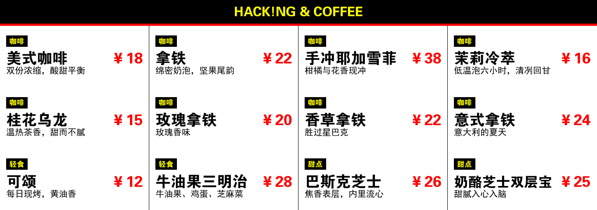
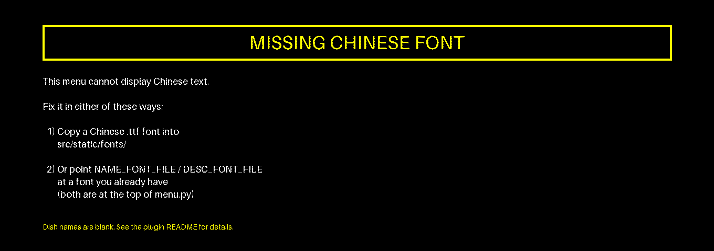
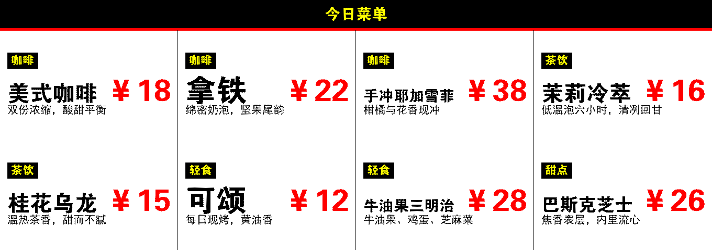
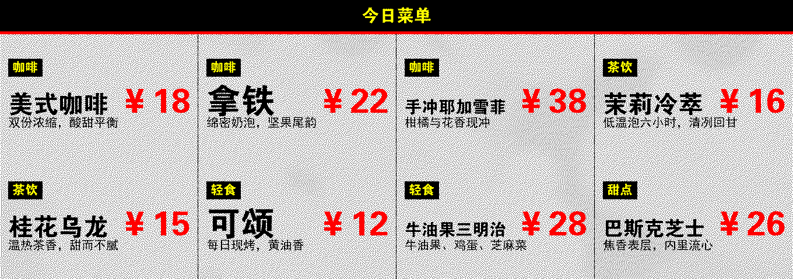

# InkyPi for Waveshare 10.85" 4-Colour e-Paper (G)

Run [InkyPi](https://github.com/fatihak/InkyPi) on a **Raspberry Pi Zero 2 W** driving the
**Waveshare 10.85-inch 4-colour e-Paper (G)** — 1360×480, black / white / yellow / red.



> 中文文档：[README.zh-CN.md](README.zh-CN.md)

---

## Why this repository exists

Upstream InkyPi has **no driver for this panel**, and its display layer would render it wrong
even if one were dropped in:

| Problem | Detail |
|---|---|
| **No upstream driver** | The official Waveshare repo `waveshareteam/e-Paper` has 242 paths mentioning "10.85" and **not one** of them is the `(G)` 4-colour variant. `install.sh -W epd10in85g` returns **404**. |
| **Half-width geometry** | The panel is driven by **two** SSD1681 controllers, each 680 px wide. Upstream takes `width, height` from the device config, which for this panel is the **single-IC** width — so upstream renders a 680×480 image and the picture is squashed to the left half. |
| **Rotation** | The HAT sits upside down on the Pi, so the framebuffer has to be rotated 180° before it goes out. |
| **4-colour quantisation** | The panel only accepts 4 real colours. Greys have to be dithered, and a naive RGB→4-colour conversion produces visible noise. |
| **Refreshing** | A 4-colour panel cannot do partial refresh, so every update goes through the full `Init → Clear → display → sleep` cycle. |

This repository ships the driver, the framework fixes, four purpose-built plugins and a
one-command installer. It is a **complete, self-contained InkyPi distribution** — all 25
upstream plugins are included and keep working.

---

## Hardware

| | |
|---|---|
| Board | Raspberry Pi Zero 2 W (any 40-pin Pi with SPI works) |
| Panel | Waveshare 10.85" e-Paper (G) — 1360×480, 4 colours |
| HAT | Waveshare e-Paper HAT (G) |
| Interface | SPI |
| Tested on | Debian 13 (trixie) arm64, Python 3.13 |

### Pinout used by the driver

| Signal | BCM GPIO | Function |
|---|---|---|
| SCK | 11 | SPI clock |
| MOSI | 10 | SPI data in |
| CS_M | 8 | chip select — **master** IC (left half) |
| CS_S | 7 | chip select — **slave** IC (right half) |
| DC | 25 | data / command |
| RST | 17 | reset |
| BUSY | 24 | busy ⚠️ *see below* |
| PWR | 18 | panel power |

> ⚠️ **BUSY does not work on this panel.** It stays high no matter how it is wired — three
> pull-up/pull-down configurations were each sampled across a 25-second refresh window with
> zero transitions. The driver therefore uses a **fixed wait** instead of the BUSY line.
> See "Timing" below.

---

## Installation

### Option A — one command (recommended)

```bash
# 1. Get upstream InkyPi in place first — the directory name must be exactly InkyPi-main
cd /home/pi
git clone https://github.com/fatihak/InkyPi.git InkyPi-main

# 2. Unpack this repository next to it, then run the installer
unzip Inkypi-waveshare10.85inch-G.zip -d /home/pi
cd /home/pi/Inkypi-waveshare10.85inch-G
sudo bash install_steps.sh
```

`install_steps.sh` is **idempotent** (files it overwrites are backed up as `.bak-<timestamp>`)
and performs nine steps: fix the Chromium package mismatch, back up the files it replaces,
install the driver, apply the patch, copy the config, install the Wi-Fi setup service and
finally restart and health-check InkyPi.

> The installer expects the source tree at `/home/pi/InkyPi-main`. Override with
> `INKYPI_REPO=/path/to/your/checkout sudo -E bash install_steps.sh`.

### Option B — manual

```bash
# 0. Driver FIRST (before upstream's install.sh, which would 404 on -W epd10in85g)
cp src/display/waveshare_epd/epd10in85g.py /home/pi/InkyPi-main/src/display/waveshare_epd/
cp src/display/waveshare_epd/epdconfig.py  /home/pi/InkyPi-main/src/display/waveshare_epd/

# 1. Clone upstream
cd /home/pi && git clone https://github.com/fatihak/InkyPi.git InkyPi-main

# 2. Upstream install (it wipes and recreates the venv)
cd /home/pi/InkyPi-main/install && echo N | sudo bash install.sh

# 3. Dependencies — MUST be installed in the foreground with sudo
sudo /usr/local/inkypi/venv_inkypi/bin/pip install -r /home/pi/InkyPi-main/install/requirements.txt

# 4. Apply this repo's patch (79 files)
cd /home/pi/InkyPi-main
git apply --binary /home/pi/Inkypi-waveshare10.85inch-G/inkypi_10in85g.patch

# 5. Device configuration
sudo cp /home/pi/Inkypi-waveshare10.85inch-G/src/config/device.json /home/pi/InkyPi-main/src/config/device.json
sudo chown pi:pi /home/pi/InkyPi-main/src/config/device.json

# 6. Chinese fonts — see the next section
sudo cp /path/to/your/*.ttf /home/pi/InkyPi-main/src/static/fonts/
sudo chown pi:pi /home/pi/InkyPi-main/src/static/fonts/*.ttf

# 7. Restart
sudo systemctl restart inkypi
```

---

## Chinese fonts (required — and **not** bundled)

Chinese text needs fonts that are **not redistributable**, so they are deliberately **not**
included in this repository. Put them into `src/static/fonts/` yourself.

| Font | Used for | Free alternative (OFL / open licence) |
|---|---|---|
| `方正大黑_GBK.ttf` | dish names, headlines | **Noto Sans CJK SC Bold** (`NotoSansCJKsc-Bold.otf`) |
| `simhei.ttf` | body text, descriptions | **Noto Sans CJK SC Regular** |
| `方正魏碑_GBK.ttf` | calendar headings | Noto Serif CJK SC |
| `方正小标宋_GBK.ttf` | large headings | Noto Serif CJK SC Bold |
| `仿宋_GB2312.ttf` | document-style text | Noto Serif CJK SC |
| `楷体_GB2312.ttf` | handwriting-style text | LXGW WenKai (also open) |
| `simfang.ttf` | fallback body text | Noto Serif CJK SC |
| `simkai.ttf` | fallback handwriting | LXGW WenKai |

If you use different files, edit the two constants at the top of `src/plugins/menu/menu.py`:

```python
NAME_FONT_FILE = "方正大黑_GBK.ttf"   # bold — dish names
DESC_FONT_FILE = "simhei.ttf"         # regular — descriptions
```

**Nothing breaks if the fonts are missing.** The Menu Board plugin checks for them at render
time: without a dish-name font it draws a `MISSING CHINESE FONT` notice instead of a blank
menu, and if only the description font is missing it silently falls back to the dish-name
font.



---

## Web UI in Chinese ★

The whole InkyPi web interface is **translated into Chinese** in this fork — no language pack
to install, no extra dependency. Open `http://<your-pi>/` and the UI is already in Chinese.

| Where | What was translated |
|---|---|
| 7 framework templates | `apikeys` / `inky` / `playlist` / `plugin` / `refresh_settings_form` / `settings` / `response_modal` |
| 5 blueprints | every flash message and error string |
| 25 plugin settings pages | every form label, button and hint |
| 24 `plugin-info.json` files | plugin display names (菜单板 / 待办清单 / 万年历 / 会议室 / 天气 …) |
| Language tables | 80 locale names in `calendar/constants.py`, 8 options in `duo_calendar` |

Totals: **264 interface strings + 25 plugin display names + 80 locale names**. The document
`lang` attribute was switched from `en` to `zh-CN`.

**Deliberately left in English** — proper nouns that do not really translate:

- model names (`GPT-4.1`), comic names (`XKCD`), font names (`Jost` / `Napoli` / `Dogica`)
- colour values, API-key names, the language names themselves
- HTML `value="…"` attributes — those are the enum values posted back to the server, so
  translating them would break the form

**Your own content is never touched.** Menu items, to-do items and plugin settings are your
data; the localisation only changes the interface around them.

To go back to the English UI, restore `src/templates/`, `src/blueprints/` and
`src/plugins/*/settings.html` to their upstream versions.

---

## Plugins

All 25 upstream plugins are included. These five are the point of this fork:

### Menu Board — `menu` ★

A price list for a café or a small shop. Type dishes in the web UI; it renders a menu board
that fits the panel.



- **Manual entry** — dish name, price, one-line description and category, all in the settings page.
- **Two layouts** — *Grid* lays dishes out as cards (suits the wide panel); *Columns* groups them by category.
- **Auto-fitting type** — font sizes scale up to fill the panel and shrink back when there are more dishes.
- **Category tags** — small black-on-yellow badges.
- **Custom background** — solid colour, gradient, uploaded image or an image from a URL, plus a continuous *background intensity* slider (0–100).
- **Background-aware colours** — text and price colours follow the actual background pixels, so light backgrounds get black text with red prices, dark backgrounds get white text with yellow prices, and yellow backgrounds are forced to all-black (red on yellow is nearly invisible).
- **Colour-accurate rendering** — drawn directly with Pillow instead of headless Chromium, so every stroke lands on one of the panel's four real colours instead of dithering greys into noise.



### To-Do List — `todo_list` ★ (reworked)

Four sticky-note columns, each with its own font / text colour / background colour, plus localStorage draft memory so a half-finished edit survives a refresh. On this panel the four colours map naturally onto the four real colours.

### Meeting — `meeting` ★

Door sign + agenda, two views. Shows the room name, current status (in session / free), the
current meeting in large type, time remaining, location and the next meeting. Data source is
an ICS calendar URL (`webcal://` supported), parsed with the same `icalendar` +
`recurring-ical_events` stack the upstream calendar plugin uses — with the upstream Chinese
mojibake bug fixed.

### Duo Calendar — `duo_calendar` ★

Perpetual calendar with Chinese lunar dates, plus a right-hand to-do column. The lunar
conversion is implemented locally (no network dependency); `tools/gen_lunar_data.py`
regenerates the lookup tables and `tools/verify_lunar.py` verifies them day by day.

### Wi-Fi Setup — `wifi_setup` ★

A QR code on the panel that puts the phone straight into the pairing flow. When the Pi has
no network it starts a hotspot, paints the QR code on the e-paper and opens a 30-second
pairing window. When it *does* have a network it prints a plain URL instead — no hotspot is
opened at all.

> 🔑 **Hotspot credentials are generated per installation — nothing is shipped.**
> This repository contains **no** default password: a password written into a public
> repository is a public password. `install_steps.sh` generates a random SSID suffix and a
> random 16-character passphrase on install, writes them to
> `/etc/inkypi/wifi_setup.conf` and prints them when the run finishes. Re-running the
> installer **keeps** the credentials you already have.
>
> If no passphrase is configured, the daemon **refuses to open the hotspot** — an empty PSK
> makes NetworkManager fall back to an *open* network, which is worse than a known password
> — and only the web pairing page at `http://<pi-ip>:8765/` stays available.
>
> You can also set them yourself at any time: *Save to Playlist* on the
> `/plugin/wifi_setup` page takes priority over the config file and applies immediately.

---

## Configuration

`src/config/device.json` holds the device configuration:

```jsonc
{
  "name": "pizero",
  "orientation": "horizontal",
  "display_type": "epd10in85g",     // ← selects the 4-colour driver
  "resolution": [1360, 480],
  "playlist_config": { "playlists": [ { "name": "Default", "plugins": [ … ] } ] }
}
```

API keys for the plugins that need them (weather, Unsplash, GitHub, AI text/image) live in
`.env` and are managed from the web UI under **API Keys**. `.env` is **not** part of this
repository — create it yourself with the keys you need:

```
NASA_SECRET=
MINIMAX_API_KEY=
```

---

## e-paper constraints — please read

These come from the Waveshare manual and the panel's physics. Ignoring them damages the panel.

| Constraint | Value |
|---|---|
| Minimum interval between refreshes | **≥ 180 seconds** (enforced in `src/model.py`) |
| After every refresh | `sleep`, then power the panel down |
| Maximum time without a refresh | **≤ 24 hours** |
| Refresh time | ~21 s nominal; the driver waits a fixed **25 s** (BUSY is unusable). Large red areas need **≥ 120 s** |
| Lifetime | ~1,000,000 refreshes — at one refresh every 210 s that is roughly 6.7 years |

**Flickering during a refresh is normal.** The manual says so explicitly, and *more*
flickering means the residual image is being cleared more thoroughly.

Every refresh runs the full official cycle:

```
Init → Clear (black) → display → sleep → power off
```

The clear step matters: without it, ghosting accumulates on every wake-up.

---

## Troubleshooting

| Symptom | Cause | Fix |
|---|---|---|
| Web UI hangs forever on "update display" | Chromium package mismatch — `chromium-headless-shell` and `chromium-common` on different versions, so the V8 snapshot does not match `libchromium.so` and the renderer dies instantly | `sudo apt-get install --reinstall -y chromium chromium-common chromium-headless-shell chromium-l10n` — all four at the **same** version. `install_steps.sh` does this for you. |
| Picture squashed into the left half | Device config reports the single-IC width (680) | Use `resolution: [1360, 480]` and the patched `waveshare_display.py`, which doubles the width |
| Image upside down | HAT orientation | The patched display layer rotates 180° before sending |
| Background photo looks like noise | 4-colour dithering | Lower the background intensity slider (8–25 looks best) and use a high-contrast image |
| Red text invisible on a yellow background | Yellow/red contrast is only ~1.6:1 | The plugin forces all-black text on yellow backgrounds automatically |
| Chinese text blank | Fonts missing or named differently | Install the fonts and check the two constants in `menu.py`; the plugin shows a `MISSING CHINESE FONT` notice |
| Half-width `¥` renders as an empty box | `¥` (U+00A5) has no glyph in most Chinese fonts | The plugin uses the full-width `￥` (U+FFE5) |
| Menu content vanishes after a manual refresh | Upstream re-reads the previous image when an instance is not due yet and pushes it back to the panel | Fixed in this repo — `src/refresh_task.py` skips properly |

---

## Verifying

```bash
# 1. Decode the QR code off the panel (local, nothing is transmitted)
zbarimg --quiet --raw /home/pi/InkyPi-main/src/static/images/current_image.png

# 2. Is the pairing service running?
systemctl is-active wifi-setup.service

# 3. What does the panel show right now?
ls -la /home/pi/InkyPi-main/src/static/images/current_image.png
```

---

## Repository layout

```
Inkypi-waveshare10.85inch-G/
├── README.md               ← this file
├── README.zh-CN.md         ← Chinese documentation
├── LICENSE                 GPL-3.0 (inherited from upstream InkyPi)
├── install_steps.sh        one-command installer (9 steps, idempotent)
├── inkypi_10in85g.patch    the customisation as a diff against upstream (31 files)
├── src/                    complete source tree — upstream + customisations
│   ├── display/waveshare_epd/epd10in85g.py   ← the 4-colour driver
│   ├── display/waveshare_display.py           ← 180° rotation, full width, colour split
│   ├── model.py                               ← 180 s minimum refresh interval
│   ├── refresh_task.py                        ← playlist scheduling fix
│   ├── plugins/{menu,duo_calendar,meeting,wifi_setup}   ← the new plugins
│   └── plugins/todo_list/                     ← reworked To-Do List
├── services/               Wi-Fi setup daemon, systemd unit and config
├── tools/                  development helpers (lunar table generation / verification)
├── install/                upstream install scripts
├── docs/                   upstream documentation
├── scripts/  tests/        upstream scripts and tests
└── screenshots/            real photos of the panel
```

`src/static/fonts/` intentionally contains only the upstream Latin fonts. See
"Chinese fonts" above.

---

## License

GPL-3.0 — inherited from [InkyPi](https://github.com/fatihak/InkyPi), whose `LICENSE` file
is included verbatim.

The Chinese fonts listed above are **not** part of this repository and are **not**
redistributed with it; obtain them from a source you are entitled to use. The font files that
*are* included (`dogicapixel*`, `Jost*`, `Napoli`, `DS-DIGI`) come from upstream InkyPi and
keep their original terms.

## Credits

- **[InkyPi](https://github.com/fatihak/InkyPi)** — the upstream project this is built on (GPL-3.0).
- **[Waveshare](https://www.waveshare.com/)** — the 10.85" e-Paper (G) panel and the
  `waveshareteam/e-Paper` reference code.
