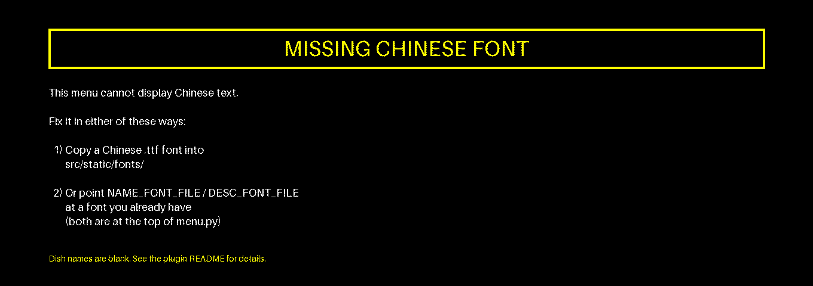
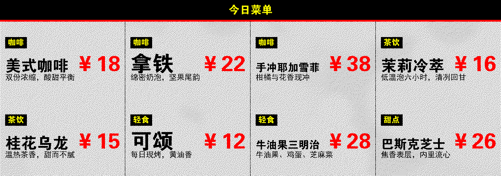

# InkyPi 适配微雪 10.85 寸四色电子墨水屏 (G)

让 [InkyPi](https://github.com/fatihak/InkyPi) 跑在 **树莓派 Pi Zero 2 W** 上，驱动
**微雪 10.85 寸四色 e-Paper (G)** —— 1360×480，黑 / 白 / 黄 / 红。


> English documentation: [README.md](README.md)

---

## 为什么会有这个仓库

10.85inch e-Paper (G) 是一块双IC控制的墨水屏，上游 InkyPi **没有这块屏的驱动**，而且即使把驱动丢进去，它的显示层也会把画面渲染错：

| 问题 | 细节 |
|---|---|
| **上游没有驱动** | 官方 Waveshare 仓库 `waveshareteam/e-Paper` 里提到 "10.85" 的路径共 242 条，**没有一条**是 `(G)` 四色版本。进行安装 `install.sh -W epd10in85g` 后会直接报 **404** 页面。 |
| **半宽几何** | 这块屏由 **两颗** SSD1681 控制器驱动，每颗IC管理 680 像素，也就是一半屏幕的区域。上游从设备配置里取 `width, height`，而配置里记的是**单IC** 宽度 —— 于是上游只渲染 680×480，画面被压到左半边。 |
| **旋转** | HAT 是倒着插在 Pi 上的，所以输出前帧缓冲要旋转 180°。 |
| **四色量化** | 面板只认 4 种真实颜色。灰度必须抖动处理，简单直接进行RGB四色转换会产生明显噪点。 |
| **刷新方式** | 四色屏不支持局部刷新，每次更新都要走完整的 `Init → Clear → display → sleep` 流程。 |

本仓库提供驱动、框架改动、五个自研/改造插件和一条命令安装脚本。它是一个**完整、自包含的 InkyPi 发行版** —— 上游 25 个插件全部保留且照常工作。

---

## 硬件

| | |
|---|---|
| 主板 | 树莓派 Pi Zero 2 W（任何带 SPI 的 40 针 Pi 都可以） |
| 面板 | 微雪 10.85 寸 e-Paper (G) —— 1360×480，四色 |
| HAT | 微雪 e-Paper HAT (G) |
| 接口 | SPI |
| 实测环境 | Raspbian latest arm64，Python 3.13 |

### 驱动用到的引脚

| 信号 | BCM GPIO | 功能 |
|---|---|---|
| SCK | 11 | SPI 时钟 |
| MOSI | 10 | SPI 数据输入 |
| CS_M | 8 | 片选 —— **主** IC（左半屏） |
| CS_S | 7 | 片选 —— **从** IC（右半屏） |
| DC | 25 | 数据 / 命令 |
| RST | 17 | 复位 |
| BUSY | 24 | 忙信号 ⚠️ *见下* |
| PWR | 18 | 面板供电 |

> ⚠️ **这块屏的 BUSY 信号不可用。** 无论怎么接都是恒高 —— 三种上拉 / 下拉配置各在 25 秒。
> 刷新窗口里采样过，**零跳变**。因此驱动改用**固定等待**而不是 BUSY 线。
> 详见下面的「时序」。

---

## 安装

### 方案 A —— 一条命令（推荐）

```bash
# 1. 先把上游 InkyPi 放到位 —— 目录名必须是 InkyPi-main
cd /home/pi
git clone https://github.com/fatihak/InkyPi.git InkyPi-main

# 2. 把本仓库解压到它旁边，然后跑安装脚本
unzip Inkypi-waveshare10.85inch-G.zip -d /home/pi
cd /home/pi/Inkypi-waveshare10.85inch-G
sudo bash install_steps.sh
```

`install_steps.sh` 是**幂等**的（它会覆盖的文件都备份成 `.bak-<时间戳>`），
一共九步：修复 Chromium 包版本错配、备份要替换的文件、安装驱动、打补丁、
复制配置、安装配网服务，最后重启并健康检查 InkyPi。

> 安装脚本默认源码树在 `/home/pi/InkyPi-main`。要改路径就用
> `INKYPI_REPO=/path/to/your/checkout sudo -E bash install_steps.sh`。

### 方案 B —— 手动安装

```bash
# 0. 先装驱动（必须在上游 install.sh 之前，否则 -W epd10in85g 会 404）
cp src/display/waveshare_epd/epd10in85g.py /home/pi/InkyPi-main/src/display/waveshare_epd/
cp src/display/waveshare_epd/epdconfig.py  /home/pi/InkyPi-main/src/display/waveshare_epd/

# 1. 克隆上游
cd /home/pi && git clone https://github.com/fatihak/InkyPi.git InkyPi-main

# 2. 上游安装（它会清空并重建 venv）
cd /home/pi/InkyPi-main/install && echo N | sudo bash install.sh

# 3. 依赖 —— 必须用 sudo 在前台装
sudo /usr/local/inkypi/venv_inkypi/bin/pip install -r /home/pi/InkyPi-main/install/requirements.txt

# 4. 打本仓库的补丁（79 个文件）
cd /home/pi/InkyPi-main
git apply --binary /home/pi/Inkypi-waveshare10.85inch-G/inkypi_10in85g.patch

# 5. 设备配置
sudo cp /home/pi/Inkypi-waveshare10.85inch-G/src/config/device.json /home/pi/InkyPi-main/src/config/device.json
sudo chown pi:pi /home/pi/InkyPi-main/src/config/device.json

# 6. 中文字体 —— 见下一节
sudo cp /path/to/your/*.ttf /home/pi/InkyPi-main/src/static/fonts/
sudo chown pi:pi /home/pi/InkyPi-main/src/static/fonts/*.ttf

# 7. 重启
sudo systemctl restart inkypi
```

---

## 中文字体（必需，且**不随包分发**）

中文需要**不可再分发**的字体，所以本仓库**刻意不包含**它们。请自己放进以下目录中：
`src/static/fonts/`。

| 字体 | 用途 | 免费替代（OFL / 开源许可） |
|---|---|---|
| `方正大黑_GBK.ttf` | 菜名、大标题 | **Noto Sans CJK SC Bold**（`NotoSansCJKsc-Bold.otf`） |
| `simhei.ttf` | 正文、介绍 | **Noto Sans CJK SC Regular** |
| `方正魏碑_GBK.ttf` | 日历标题 | Noto Serif CJK SC |
| `方正小标宋_GBK.ttf` | 大标题 | Noto Serif CJK SC Bold |
| `仿宋_GB2312.ttf` | 公文风格正文 | Noto Serif CJK SC |
| `楷体_GB2312.ttf` | 手写风格正文 | LXGW WenKai（同样开源） |
| `simfang.ttf` | 正文兜底 | Noto Serif CJK SC |
| `simkai.ttf` | 手写体兜底 | LXGW WenKai |

如果你用别的文件名，改 `src/plugins/menu/menu.py` 顶部的两个常量：

```python
NAME_FONT_FILE = "方正大黑_GBK.ttf"   # 粗体 —— 菜名
DESC_FONT_FILE = "simhei.ttf"         # 常规 —— 介绍
```

**字体缺失也不会坏掉。** 菜单板插件在渲染时会自检：缺菜名字体时画一张
`MISSING CHINESE FONT` 提示图，而不是白屏；只缺介绍字体时静默回退到菜名字体。



---

## Web 后台已汉化 ★

这个 fork 把 InkyPi 的 **Web 后台进行了汉化** —— 不需要装语言包，也不依赖任何额外组件。
打开 `http://<你的Pi>/` 就是中文界面。

| 位置 | 汉化了哪些字段 |
|---|---|
| 7 个框架模板 | `apikeys` / `inky` / `playlist` / `plugin` / `refresh_settings_form` / `settings` / `response_modal` |
| 5 个蓝图 | 所有 flash 提示与报错文案 |
| 25 个插件设置页 | 每个表单的标签、按钮、说明文字 |
| 24 个 `plugin-info.json` | 插件显示名（菜单板 / 待办清单 / 万年历 / 会议室 / 天气 …） |
| 语言表 | `calendar/constants.py` 的 80 条语言名、`duo_calendar` 的 8 条语言选项 |

合计 **264 条界面词条 + 25 个插件显示名 + 80 条语言名**，文档 `lang` 属性从 `en` 改成 `zh-CN`。

**故意保留英文**的部分：

- 模型名（`GPT-4.1`）、漫画名（`XKCD`）、字体名（`Jost` / `Napoli` / `Dogica`）
- 颜色值、API key 名、语言名本身
- HTML 的 `value="…"` 属性 —— 那是提交回后端的枚举值，翻译了表单会直接坏掉

**你自己的内容一个字都不会被改。** 菜单条目、待办条目、插件设置都是你的数据，
汉化只动界面层。

想换回英文界面：把 `src/templates/`、`src/blueprints/`、`src/plugins/*/settings.html`
恢复成上游版本即可。

---

## 插件

上游 25 个插件全部保留。以下五个是这个 fork 的重点：

### 菜单板 —— `menu` ★

给咖啡馆或小店的价目表。在网页里录入菜品，渲染成适配这块屏的菜单板。


- **手工录入** —— 菜名、价格、一行介绍、分类，全在设置页里填。
- **两种版式** —— *网格* 把菜品排成卡片（适合宽屏）；*分栏* 按分类归拢。
- **字号自适应** —— 字号自动放大填满面板，菜品变多时又自动缩回去。
- **分类标签** —— 黑底黄字的小徽章。
- **自定义背景** —— 纯色、渐变、上传图片或网络图片，再配一个 0–100 的连续*背景浓度*滑块。
- **随背景换配色** —— 文字和价格颜色按背景实际像素决定：浅底配黑字红价，深底配白字黄价，黄底强制全黑（红字在黄底上几乎看不见）。
- **配色准确** —— 用 Pillow 直绘而不走无头 Chromium，每一笔都落在面板的四种真实颜色上，不会把灰色抖动成噪点。



### 待办清单 —— `todo_list` ★（改造过）

四列便利贴，每列独立设置字体 / 文字颜色 / 背景颜色，外加 localStorage 草稿记忆，
写一半刷新也不丢。在这块屏上，四个颜色正好对应四种真实颜色。

### 会议室 —— `meeting` ★

门牌 + 议程，两个视图。显示房间名、当前状态（开会中 / 空闲）、当前会议的大字号标题、
剩余时间、地点和下一场会议。数据源是一个 ICS 日历 URL（支持 `webcal://`），
用上游日历插件同一套 `icalendar` + `recurring-ical_events` 解析 —— 并修掉了上游的中文乱码 bug。

### 万年历 —— `duo_calendar` ★

带农历的常驻日历，右侧带一列待办。农历换算在本地实现（不依赖网络）；
`tools/gen_lunar_data.py` 重新生成查表数据，`tools/verify_lunar.py` 逐日校验。

### 配网 —— `wifi_setup` ★

在面板上画二维码，手机扫一下直接进配网流程。Pi 没有网络时会开热点、把二维码刷到墨水屏上、
打开 30 秒配网窗口；有网络时只显示一个纯文本 URL，**根本不开热点**。

> 🔑 **热点凭据按安装实例随机生成 —— 仓库里不带任何默认凭据。**
> 本仓库**没有**默认密码：写进公开仓库的密码，就是公开的密码。
> `install_steps.sh` 会在安装时随机生成一个 SSID 后缀和一个 16 位随机密码，写进
> `/etc/inkypi/wifi_setup.conf`，并在安装结束时打印出来；重跑安装脚本会**保留**你已有的凭据。
>
> 如果没有配置密码，守护进程会**拒绝开启热点** —— 空 PSK 会让 NetworkManager 退化成
> *开放网络*，那比「密码是公开值」更糟 —— 只保留 http://<本机IP>:8765/ 这个网页配网入口。
>
> 也可以随时自己改：在 `/plugin/wifi_setup` 页面改完点 *保存到播放列表*，
> 网页里存的实例参数**优先于**配置文件，即时生效。

---

## 配置

`src/config/device.json` 保存设备配置：

```jsonc
{
  "name": "pizero",
  "orientation": "horizontal",
  "display_type": "epd10in85g",     // ← 选择四色驱动
  "resolution": [1360, 480],
  "playlist_config": { "playlists": [ { "name": "Default", "plugins": [ … ] } ] }
}
```

需要 API Key 的插件（天气、Unsplash、GitHub、AI 文本 / 图片）的密钥放在 `.env` 里，
在网页端 **API Keys** 页面管理。`.env` **不属于本仓库** —— 请自己创建并填你需要的键：

```
NASA_SECRET=
MINIMAX_API_KEY=
```

---

## 墨水屏硬约束 —— 必读

这些来自微雪10.85inch(G)手册和面板本身的物理特性，忽略会伤屏。

| 约束 | 数值 |
|---|---|
| 两次刷新之间的最小间隔 | **≥ 180 秒**（在 `src/model.py` 里强制） |
| 每次刷新之后 | `sleep`，然后给面板断电 |
| 最长不刷新时间 | **≤ 24 小时** |
| 刷新耗时 | 标称 ~21 秒；驱动固定等 **25 秒**（BUSY 不可用）。大面积红色需要 **≥ 120 秒** |
| 寿命 | 约 100 万次刷新 —— 按 210 秒一次算，大约 6.7 年 |

**刷新过程中的闪烁是正常现象。** 手册里明写了，而且闪得越多，残影清得越干净。

每次刷新都走完整的官方流程：

```
Init → Clear（黑色）→ display → sleep → 断电
```

清屏这一步很关键：少了它，每次唤醒都会累积残影。

---

## 故障排查

| 现象 | 原因 | 解决 |
|---|---|---|
| 网页端「更新显示」一直卡住 | Chromium 包版本错配 —— `chromium-headless-shell` 和 `chromium-common` 版本不一致，V8 快照对不上 `libchromium.so`，渲染进程瞬间挂掉 | `sudo apt-get install --reinstall -y chromium chromium-common chromium-headless-shell chromium-l10n` —— 四个包必须**同版本**。`install_steps.sh` 会替你做。 |
| 画面被压到左半边 | 设备配置里是单 IC 宽度（680） | 用 `resolution: [1360, 480]` 配打补丁后的 `waveshare_display.py`，它会把宽度翻倍 |
| 画面上下颠倒 | HAT 安装方向 | 打过补丁的显示层会在输出前旋转 180° |
| 背景照片像一团噪点 | 四色抖动 | 把背景浓度滑块调低（8–25 最好看），并用高对比度图片 |
| 黄底上红字看不见 | 黄 / 红对比度只有约 1.6:1 | 插件会在黄底上自动强制全黑文字 |
| 中文显示为空白 | 字体缺失或文件名不同 | 装好字体并检查 `menu.py` 里的两个常量；插件会显示 `MISSING CHINESE FONT` 提示 |
| 半角 `¥` 显示成空方框 | `¥`（U+00A5）在多数中文字体里没有字形 | 插件用的是全角 `￥`（U+FFE5） |
| 手动刷新后菜单内容消失 | 实例未到刷新时间时，上游会重读上一张图再推回面板 | 本仓库已修 —— `src/refresh_task.py` 会正确跳过 |

---

## 验证

```bash
# 1. 扫码识别面板上的二维码（纯本地识别，不上传任何数据）
zbarimg --quiet --raw /home/pi/InkyPi-main/src/static/images/current_image.png

# 2. 配网服务在跑吗？
systemctl is-active wifi-setup.service

# 3. 面板现在显示的是什么？
ls -la /home/pi/InkyPi-main/src/static/images/current_image.png
```

---

## 仓库结构

```
Inkypi-waveshare10.85inch-G/
├── README.md               ← 英文文档
├── README.zh-CN.md         ← 本文件
├── LICENSE                 GPL-3.0（继承自上游 InkyPi）
├── install_steps.sh        一键安装脚本（九步，幂等）
├── inkypi_10in85g.patch    针对上游的定制差异包（31 个文件）
├── src/                    完整源码树 —— 上游 + 定制
│   ├── display/waveshare_epd/epd10in85g.py   ← 四色驱动
│   ├── display/waveshare_display.py           ← 180° 旋转、全宽、左右分色
│   ├── model.py                               ← 180 秒最小刷新间隔
│   ├── refresh_task.py                        ← 播放列表调度修复
│   ├── plugins/{menu,duo_calendar,meeting,wifi_setup}   ← 新增插件
│   └── plugins/todo_list/                     ← 改造后的待办清单
├── services/               配网守护进程、systemd unit 与配置
├── tools/                  开发辅助脚本（农历表生成 / 校验）
├── install/                上游安装脚本
├── docs/                   上游文档
├── scripts/  tests/        上游脚本与测试
└── screenshots/            面板实拍图
```

`src/static/fonts/` 里**有意**只保留上游的拉丁字体。参见上面的「中文字体」。

---

## 许可

GPL-3.0 —— 继承自 [InkyPi](https://github.com/fatihak/InkyPi)，其 `LICENSE` 文件已原样包含在内。

上面列出的中文字体**不属于本仓库**，也**不随本仓库再分发**；请从你有权使用的渠道获取。
仓库中**确实包含**的字体文件（`dogicapixel*`、`Jost*`、`Napoli`、`DS-DIGI`）来自上游 InkyPi，保留其原有条款。

## 致谢

- **[InkyPi](https://github.com/fatihak/InkyPi)** —— 本项目所基于的上游项目（GPL-3.0）。
- **[Waveshare](https://www.waveshare.com/)** —— 10.85 寸 e-Paper (G) 面板与 `waveshareteam/e-Paper` 参考代码。
